<a href="https://satyaranjan.vercel.app/">Portfolio</a> &nbsp;·&nbsp;
<a href="https://www.linkedin.com/in/satyaranjan-behera-532a422a9/">LinkedIn</a> &nbsp;·&nbsp;
<a href="https://satyaranjan.vercel.app/Satya_Resume.pdf">Resume</a> &nbsp;·&nbsp;
<a href="mailto:satyabhr2005@gmail.com">Email</a>

<a href="https://github.com/SaTyAbHr2005/AirInsight-Intelligent-Air-Quality-Analytics-Platform">AirInsight</a> ·
<a href="https://ieeexplore.ieee.org/document/11570468">IEEE paper</a> ·
<a href="https://github.com/SaTyAbHr2005/CrowdWatch-AI">CrowdWatch AI</a> ·
<a href="https://github.com/SaTyAbHr2005/AutoSOC---AI-Based-Unified-Security-Monitoring-and-Vulnerability-Platform">AutoSOC</a> ·
<a href="https://github.com/SaTyAbHr2005/FwdCheck">FwdCheck</a> (<a href="https://fwd-check.vercel.app">live</a>) ·
<a href="https://github.com/SaTyAbHr2005/Energy-Consumption-Forecasting">EnergySense</a> (<a href="https://energysense.vercel.app/">live</a>) ·
<a href="https://github.com/SaTyAbHr2005/AI-SDPIP-Smart-Data-Processing-with-Intelligent-Automation">AI-SDPIP</a> (<a href="https://ai-sdpip-smart-data-processing-with-intelligent-automation-kmr.streamlit.app/">live</a>)

<a href="https://satyaranjan.vercel.app/">Portfolio</a> &nbsp;·&nbsp;
<a href="https://www.linkedin.com/in/satyaranjan-behera-532a422a9/">LinkedIn</a> &nbsp;·&nbsp;
<a href="mailto:satyabhr2005@gmail.com">Email</a> &nbsp;·&nbsp;
<a href="https://leetcode.com/u/Satya252005/">LeetCode</a> &nbsp;·&nbsp;
<a href="https://satyaranjan.vercel.app/Satya_Resume.pdf">Resume</a>

